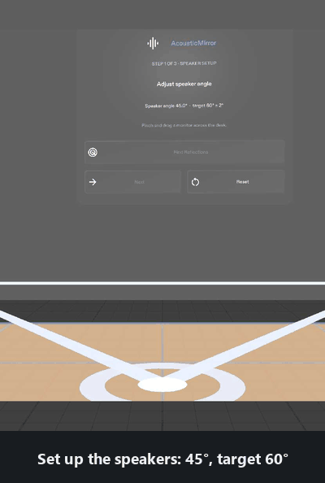
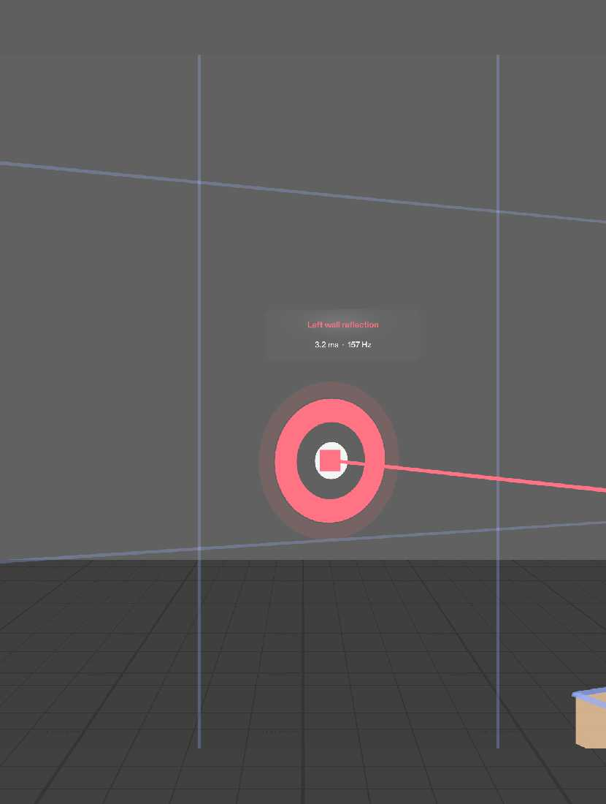
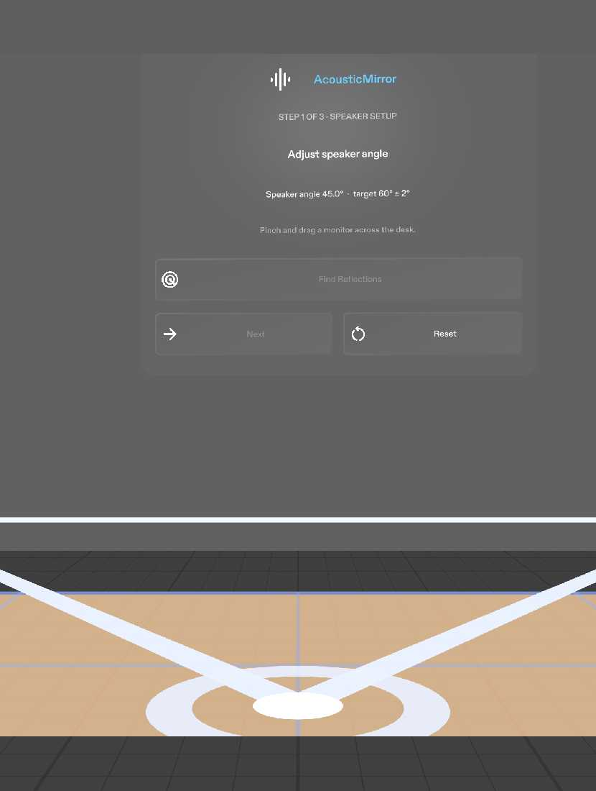
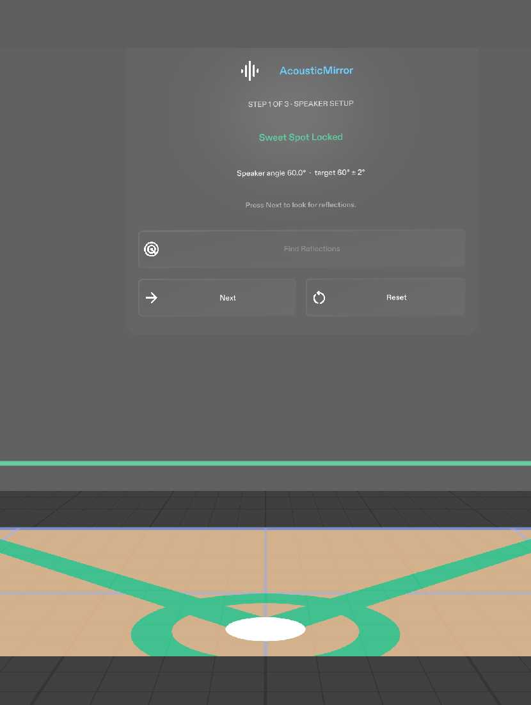
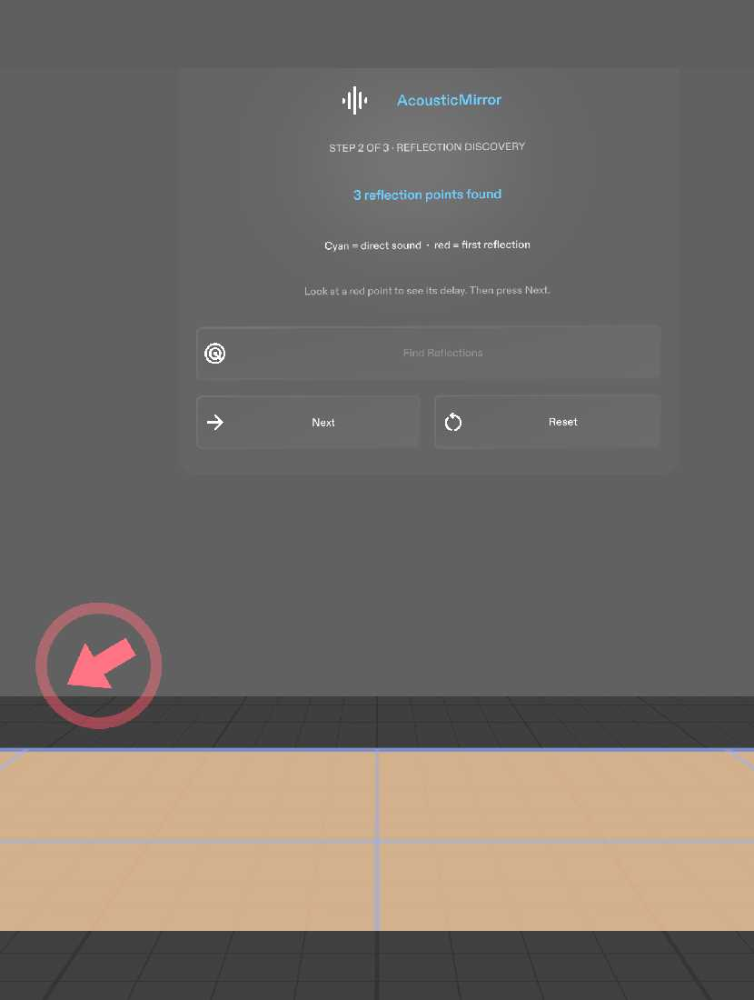
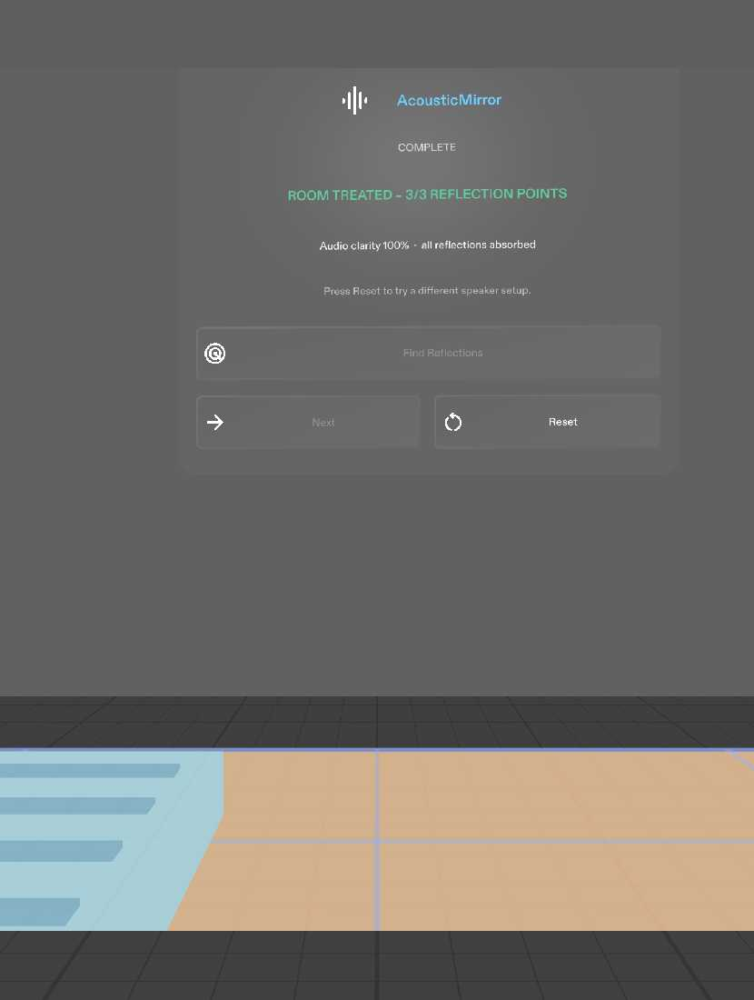
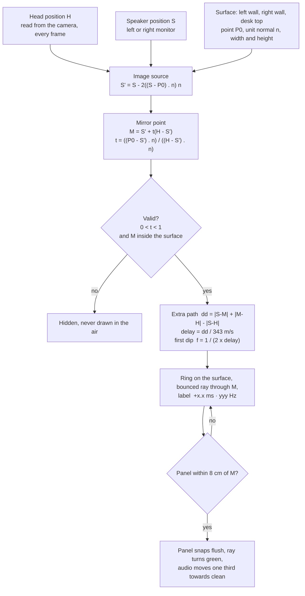
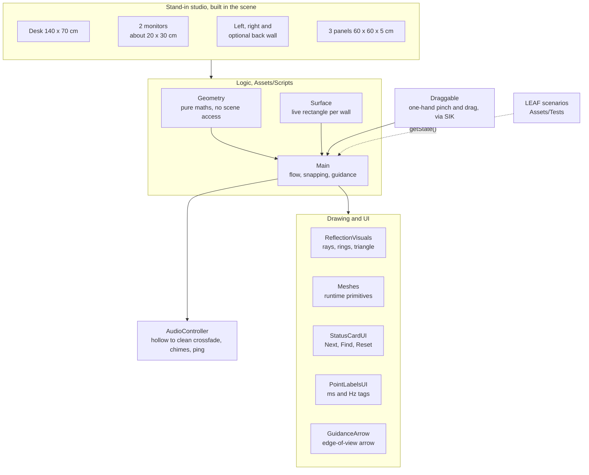

<!--
  TODO before submitting: add a docs/demo.gif, then uncomment the image block below.
-->

<h1 align="center">AcousticMirror</h1>

<b>Do the studio "mirror trick" alone.</b> Find the wall reflections that ruin your monitors' sound, and fix them, with AR glasses that sit exactly where your ears are.

<!--

  

-->

  
  
  
  
  

  <a href="#you-are-alone-in-the-room">The problem</a> ·
  <a href="#what-acousticmirror-does">What it does</a> ·
  <a href="#a-walk-through-the-lens">Walk-through</a> ·
  <a href="#how-it-thinks">How it thinks</a> ·
  <a href="#architecture">Architecture</a> ·
  <a href="#why-glasses">Why glasses</a> ·
  <a href="#what-it-cannot-do-yet">Limits</a> ·
  <a href="#run-it">Run it</a>

---

## You are alone in the room

You have just set up a pair of studio monitors on your desk. The mix sounds hollow. Some notes vanish, the bass is thin, and you cannot tell why.

The usual cause is the walls. Sound from each speaker travels to your ears twice: once straight, and once after bouncing off the side wall or the desk. The bounced copy arrives a few milliseconds late, and the two cancel each other at some frequencies. The result is a "comb" of dips: hollow, phasey, wrong.

Studio engineers find the spot on the wall where that bounce happens with the **mirror trick**. One person sits at the listening position. A second person slides a mirror along the wall until the first can see the speaker in it. That spot is the reflection point, and a panel goes there.

It needs two people. If you work alone, you guess.

**AcousticMirror was built for that moment.**

The scene is illustrative. Every number the Lens shows is computed from the geometry in the preview scene, and the maths is in [How it thinks](#how-it-thinks).

## What AcousticMirror does

The glasses sit at your head, so your head **is** the listening position. The Lens takes the place of the second person:

1. **Set up the speakers.** Drag each monitor along the desk until the two speakers and your head form a 60° triangle. The lines turn green, a chime plays and the card says **Sweet Spot Locked**.
2. **Find the reflections.** Press **Find Reflections**. For each speaker the Lens works out where its sound bounces off the left wall, the right wall and the desk on its way to your head. A cyan ray shows the direct sound, a red ray shows the bounce, and a glowing ring marks the point on the surface with its delay in milliseconds and the frequency it cancels.
3. **Treat the room.** Pick up a 60 × 60 cm absorber panel and put it on a ring. Within 8 cm it snaps on flush with the surface, the ray turns green, and the sound moves one third of the way from hollow to clean.
4. **Done.** When all three points are treated, the rays are green, a chime plays, the audio is clean, and the card reads **Room Treated – 3/3 Reflection Points**. **Reset** puts everything back.

**Walk sideways and the rings move with you.** That is the proof the geometry is live, not animated: the reflection points are recomputed every frame from where your head is.

### Three promises

- **The geometry is real.** A real image-source calculation runs every frame, with your head position read from the camera. Nothing is baked or pre-recorded.
- **A point that cannot happen is never drawn.** A reflection is shown only if it lands on the actual wall or desk, inside its edges. Otherwise it is hidden rather than drawn in mid-air.
- **The audio is honest about what it is.** The hollow-to-clean change is a simulated improvement, a loop mixed with a copy delayed by about 3.5 ms against the same loop dry. It is not a measurement of any room.

## A walk through the Lens

  
   <b>A reflection point.</b> Turn to the left wall and the ring is there, on the wall, where the left speaker's sound bounces to your ears. The tag opens when you look at it: 3.2 ms late, cancelling sound near 157 Hz.

<table>
<tr>
<td width="50%"> <b>Speaker setup.</b> The card shows the live angle between the speakers, 45° against a target of 60°. The triangle runs from each monitor to the marker at your listening position.</td>
<td width="50%"> <b>Sweet spot locked.</b> At 60° the triangle turns green, a chime plays and <b>Next</b> unlocks.</td>
</tr>
<tr>
<td> <b>Reflections found, out of view.</b> Three points are found, but none is in the narrow SPECS view while you face the desk. A red arrow at the edge of the view points to one, with a soft ping.</td>
<td> <b>Room treated.</b> All three points have a panel. The rays are green, a chime plays, the audio is fully clean, and <b>Reset</b> starts again.</td>
</tr>
</table>

All screenshots are from the Lens Studio preview, which shows the narrow SPECS display window. The grey background stands in for the real room, since the display is additive.

| Step | What you see | What you do |
|---|---|---|
| **1. Speaker setup** | The desk, the two monitors, a listening-position marker, and a three-line triangle (left monitor, right monitor, your head). The card shows the live angle. | Drag a monitor along the desk. At 60° (±2°) the triangle turns green, a chime plays, **Next** unlocks. |
| **2. Reflection discovery** | Cyan direct rays, red reflected rays, and a glowing ring at each of the three points. The triangle fades. Each ring starts as a small dot and expands to `+x.x ms · yyy Hz` when you look at it. | Press **Find Reflections**. Walk around and watch the rings move. |
| **3. Room treatment** | The panel rack appears beside the desk. Direct rays fade so the untreated points stand out. | Drag a panel to a ring. It snaps within 8 cm, the ray turns green, the card shows `1/3 Treated`. |
| **Out of view** | The side walls sit outside the narrow SPECS window while you face the desk. A small arrow appears at the edge of the view pointing to an untreated point, with a soft ping. | Turn towards it. The arrow disappears when the ring is in view. |
| **4. Complete** | All rays and rings green, a completion chime, clean audio, `ROOM TREATED – 3/3 REFLECTION POINTS`. | Press **Reset** to try a different speaker setup. |

All input is a one-hand pinch and drag through the Spectacles Interaction Kit. In the preview, a mouse click is the pinch. There are no custom gestures and no voice.

## How it thinks

**Sanity check.** A delay of 3.8 ms gives a first dip near 132 Hz.

### Where each choice comes from

| Decision | Why |
|---|---|
| Image-source method | A bounce off a flat wall is exactly a straight line from a mirror image of the speaker to your head. It is the same picture as the mirror trick, so the maths and the technique agree. |
| Head from the camera, every frame | The glasses sit at your head. This is what a phone on the desk cannot do, and it is why the rings follow you. |
| Walls and desk read from the scene transforms | `AcousticMirrorSurface` takes its rectangle live from its own transform. Move a wall in the scene and the maths moves with it. A detected real wall would be used the same way. |
| One third of the audio mix per panel | It makes each placement audible, so the A/B reads clearly in the demo. |
| Field of view about 37° tall by 32° wide | The real SPECS display window. It decides when the edge arrow shows, using the same test the LEAF scenario uses. |
| Bright colours only | The display is additive: black is transparent. Cyan `#38BDF8` for direct, red `#F43F5E` for untreated, green `#10B981` for locked or treated. |

## Architecture

| Layer | Built with |
|---|---|
| Platform | Lens Studio 5.23.2, targeting Snap Spectacles |
| Language | TypeScript |
| Interaction | Spectacles Interaction Kit (SIK): pinch, drag, hover |
| UI | Spectacles UI Kit: back plates, buttons, flex layout |
| Spatial audio | Two looping beds played from the monitors, plus one-shot cues |
| Tests | LEAF scenarios in `Assets/Tests`, plus a scripted self-test |

### Scripts

| File | Job |
|---|---|
| `AcousticMirrorGeometry.ts` | Pure maths: the image-source solver, the speaker-triangle angle, and the field-of-view test. No scene access. |
| `AcousticMirrorSurface.ts` | One reflecting surface (a wall or the desk). Its rectangle comes live from its transform. |
| `AcousticMirrorMain.ts` | The orchestrator. It owns the step flow, the 60° lock, the reflection points, panel snapping, the treated count, the edge arrow and the audio mix. |
| `AcousticMirrorDraggable.ts` | A one-hand pinch-and-drag prop (monitor or panel) built on SIK. It does not clamp or snap itself. Main does. |
| `AcousticMirrorReflectionVisuals.ts` | The triangle, the listening marker, the direct and reflected rays, and the rings. |
| `AcousticMirrorMeshes.ts` | Cached runtime primitives and tinted unlit materials. |
| `AcousticMirrorStatusCardUI.ts` | The floating card above the right desk corner, with the Next, Find Reflections and Reset buttons. |
| `AcousticMirrorPointLabelsUI.ts` | Small tags at each point. They show only while you look towards the point. |
| `AcousticMirrorGuidanceArrow.ts` | The arrow at the edge of the view. It never decides when to show. Main does. |
| `AcousticMirrorAudioController.ts` | The hollow-to-clean crossfade, the chimes, the ping and the snap sound. |
| `AcousticMirrorSelfTest.ts` | Debug only. A scripted walkthrough that prints a pass or fail line per done criterion. Off by default. |

## Why glasses

| Strength of glasses | How AcousticMirror uses it |
|---|---|
| **It shares your view** | The glasses are at your head, so the listening position is your head. A phone on the desk does not know where your ears are. |
| **It draws in the world** | The rays, rings and panel targets appear on your walls and desk at real size, in the spot where the sound goes wrong, not on a 2D graph. |
| **It leaves your body free** | Both hands are free to move speakers and panels while you walk to the wall and the rays update. |

The glasses replace the second person in the mirror trick.

## Done criteria and tests

Every criterion from the [design brief](devpost/design-brief.md) has a LEAF scenario in `Assets/Tests`.

**Final run: 6 of 6 pass** in the Lens Studio 5.23.2 preview (LEAF 2.0.2, SIK 0.18.0). The full suite was run several times, and every scenario passed on every run.

| # | Criterion | Scenario | Result | What the scenario checks |
|---|---|---|---|---|
| 1 | Dragging a monitor to about 60° turns the triangle green and shows Sweet Spot Locked | `c1-speaker-positioning` | ✅ Pass | Starts at 45°, not locked, Next disabled. A drag to about 53° stays unlocked. A drag to 59.8° locks, plays the lock chime, turns the triangle green, shows "Sweet Spot Locked" and enables Next. The monitor stays on the desk. |
| 2 | Find Reflections shows rays and three valid points, each with ms and Hz | `c2-reflection-points` | ✅ Pass | Three points, on the left wall, right wall and desk, with 0 < t < 1. Each lies on its surface and inside its edges. Each matches an independent image-source calculation in the test to within 0.1 cm, with delay and frequency matching too. Direct rays are cyan and reflected rays red. Looking at a point shows its ms and Hz tag; looking away hides it. |
| 3 | Walking sideways moves the points | `c3-points-follow-head` | ✅ Pass | Moving the head 30 cm left, 30 cm right and 20 cm forward moves every point. Each new point matches the calculation for the new head position, and the rays still meet exactly at it. |
| 4 | A panel within 8 cm snaps, the ray turns green, the counter rises | `c4-panel-snap` | ✅ Pass | A panel 16 cm from the point does not snap. Dragged onto the point, it snaps flush and centred, that ray turns green while the others stay red, the card shows "1/3 Treated" and the audio mix moves to one third. |
| 5 | All three treated: green, chime, clean audio, 3/3, and Reset restores everything | `c5-room-treated-reset` | ✅ Pass | Three panel drags move the mix to 1/3, 2/3, then 1. All rays and rings turn green, the completion chime plays, only the clean loop is audible and the card reads "ROOM TREATED – 3/3 REFLECTION POINTS". Reset restores step 1, a count of 0, hidden rays, the hollow audio, and the start positions of the monitors and panels. |
| 6 | An off-screen point shows the edge arrow, and turning back hides it | `c6-out-of-view-arrow` | ✅ Pass | Facing the desk, the left-wall point is outside the 32° × 37° view. Turning away from every point shows the arrow with a new ping, inside the view near its edge and pointing at its target. Turning towards the point hides the arrow and shows the point and its tag. |

The scenarios use real input: SIK pinch-drags on the monitors and panels, SIK triggers on the UI Kit buttons, and real moves and turns of the preview camera. They read the result through `getState()` and check positions, delays, frequencies and the field of view against their own calculations, not the Lens's. To run them, open the LEAF panel in Lens Studio and run each scenario on the preview.

**What the tests cannot check:** how the hollow and clean audio actually sound (they check which sounds play and at what volume), how the glow looks (colours are read from material values), and real hand tracking on glasses.

### Logic proven, feel unproven

| Logic, checked in the preview | Feel, only real glasses can tell |
|---|---|
| The reflection maths and its validity rules | Whether turning to find the side-wall rings feels natural |
| Rings and rays follow the head | Whether the rays and rings stay readable against a bright real room on the additive display |
| Snapping, treated count, reset | Whether real hand tracking makes dragging a panel comfortable |
| The edge arrow shows and hides on the SPECS field of view | Whether the glasses' speakers reproduce the low frequencies in the hollow loop |

## What it cannot do yet

- **No real room scanning.** The preview uses a virtual studio at real scale: a desk, two monitors, left and right walls, an optional back wall and a panel rack. On real glasses, the walls would come from surface detection, and the same maths would use them.
- **No microphone, no measurement.** The audio is a simulated improvement. Nothing is measured from a real room.
- **First bounce only.** Ceiling and back-wall reflections, and bounces beyond the first, are out of scope.
- **Fixed mapping.** Three points, one each for the left wall, right wall and desk. Any panel can treat any point.
- **One-hand gestures only.** No two-hand or custom gestures, and no voice.
- **Nothing is saved** between sessions.
- **No glasses were used.** Comfort over time and real hand tracking are untested.

### Next

- Real walls and desk from surface detection, replacing the stand-ins.
- Measuring the room with the microphone so the dips shown are the dips heard.
- Ceiling reflections and second bounces.
- Running the LEAF suite on a real SPECS device.

## Run it

Requires **Lens Studio 5.23.2**. Newer versions (5.24) can block sign-in for the agent tools.

1. Clone this repository. The project uses Git LFS for `Assets/` and `Packages/`, so install it first (`git lfs install`).
2. Open `AcousticMirrorLens Lens Studio.esproj` in Lens Studio 5.23.2.
3. Open the **Preview** panel and choose **Interactive Preview**. No glasses are needed.

| Control | Action |
|---|---|
| **W A S D** | Walk. The reflection rings move with you. |
| **Q / E** | Move down / up. |
| **Right-drag** or hold **Shift** | Look around. |
| **Left click** | Acts as a pinch. Drag a monitor or a panel, press a button. |

A first run: drag a monitor until the card says **Sweet Spot Locked**, press **Next**, press **Find Reflections**, turn to the side wall, drag a panel onto the glowing red ring, and listen.

To run the scripted walkthrough instead, set `runOnStart` on `AcousticMirrorSelfTest` and watch the Logger for `PASS` and `FAIL` lines. Leave it off for normal use.

## How it was built

Built for the **Learn AR with SPECS** hackathon, using the required tools:

1. **Plan:** the Devpost Learn skill pack's `plan-lens` interview produced the approved [design brief](devpost/design-brief.md).
2. **Build:** CLAD and the Lens Studio MCP built the Lens from that brief.
3. **Verify:** LEAF scenarios check each done criterion in the preview. All six pass.

## Disclosure

- **Lens Studio SPECS base template**, Spectacles Interaction Kit, Spectacles UI Kit and the LEAF package are used as shipped with Lens Studio.
- The audio loops and chimes in `Assets/GeneratedSFX` were generated for this Lens. No copyrighted music is used anywhere.
- All Lens code was written during the hackathon period.

## Sources

- Hackathon: Learn AR with SPECS, <https://learn-specs.devpost.com/>
- Lens Studio and Spectacles documentation: <https://developers.specs.com/>
- Speed of sound in air: 343 m/s at about 20 °C, used for the delay.

 <b>AcousticMirror</b> · See where your sound goes wrong, and fix it, on your own.

